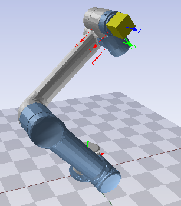
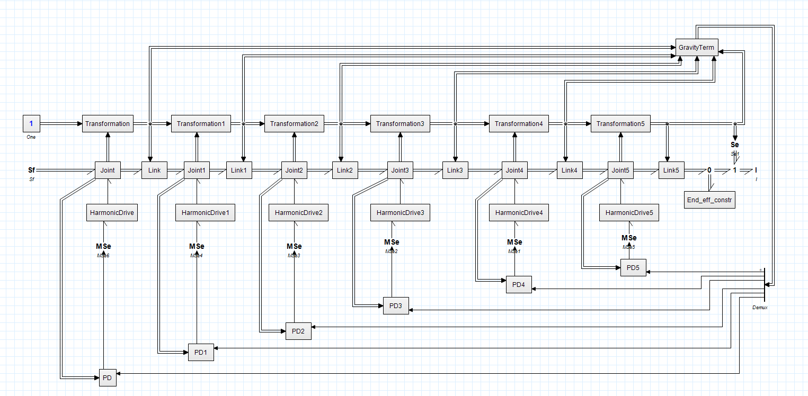
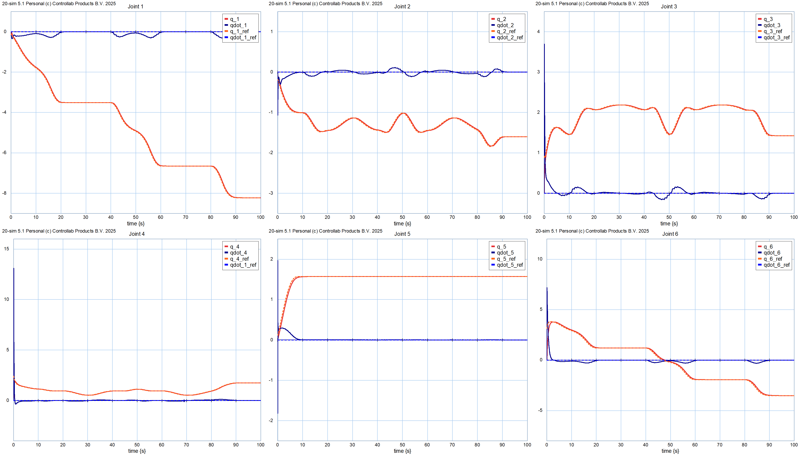
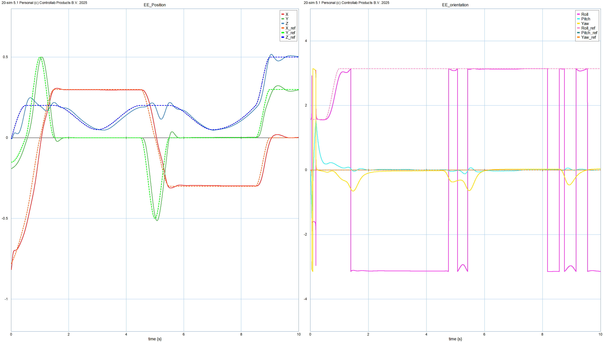

# UR5 Robot Bond-Graph Model

A complete, physically based **bond-graph model of the Universal Robots UR5** 6-DOF manipulator, built in **20-sim**. The model includes:

- nonlinear harmonic-drive transmissions,
- a PID controller with gravity compensation,
- closed-form inverse kinematics,
- a switchable payload for pick-and-place tasks.

This is a project for the *Modeling and Simulation of Mechatronic Systems* course, part of the Master's Degree in Automation Engineering at the University of Bologna (A.Y. 2025/26).

<p align="center">
  
</p>

---

## Highlights

- **Modular, reusable sub-models.** `Link`, `Joint`, `Transformation`, `HarmonicDrive`, `PD`/PID, `GravityTerm` and `IK` are 20-sim library blocks. They are assembled into six identical "robot units".
- **Newton–Euler dynamics in twist/wrench form.** Each link is a 6-DOF I-field. Modulated transformers (MTFs) carry out both the Denavit–Hartenberg frame changes and the shift to the centre of mass.
- **Full integral causality.** Joint constraints are enforced with constraint elements instead of derivative causality, so the assembled model integrates cleanly with BDF solvers.
- **Realistic harmonic drives.** These include:
  - nonlinear (cubic) flex-spline stiffness,
  - asymmetric Coulomb and viscous friction on both shafts,
  - reflected rotor inertia,
  - structural damping to suppress the elastic mode.
- **Task-space trajectory tracking:**
  1. A Python PCHIP planner writes the reference trajectory to a CSV file.
  2. The 20-sim `DataFromFile` block reads the CSV.
  3. A pose-to-SE(3) planner turns each pose into a target transform.
  4. The closed-form UR5 IK solver computes the joint angles.
  5. A phase-unwrapping stage removes 2π jumps.
  6. Six PID + gravity-feedforward controllers track the joint references.
- **Switchable payload.** A `SwitchingZeroJunction` driven by a `Cond` flag in the trajectory attaches and releases a 1 kg load. The rigid connection is a stiff C element with an R damper, so integral causality is kept in both modes.
- **3D visualisation.** The 20-sim 3D Mechanics toolbox animates the arm using the UR5 STL meshes.

## Architecture

<p align="center">
  
</p>

| Sub-model | Role |
|---|---|
| **Link** | Rigid body (mass, inertia, CoM offset). Integrates the Newton–Euler equations and injects gravity rotated into the body frame. |
| **Joint** | Revolute joint. Applies the DH transformation through an MTF, constrains 5 DOFs, exposes the actuated axis and outputs `q`, `q̇` and `ⁱ⁻¹Tᵢ`. |
| **Transformation** | Signal block that chains `⁰Tᵢ = ⁰Tᵢ₋₁ · ⁱ⁻¹Tᵢ` and provides poses for gravity, visualisation and compensation. |
| **HarmonicDrive** | Strain-wave gearbox (N = 100) with nonlinear compliance, friction and structural damping. |
| **PID** | Decentralised per-joint control law: `τ = Kp(q* − q) − Kd·q̇ + Ki∫(q* − q) + g(q)`. |
| **GravityTerm** | Closed-form gravity torque vector `g(q)` computed from the transformation chain (plus the payload when it is attached). |
| **IK** | Analytical UR5 inverse kinematics with selectable shoulder, elbow and wrist configurations. |

## Results

The test scenario is a 10 s pick-and-place cycle. The arm picks a 1 kg load (unknown to the controller's model), carries it and releases it. Then it returns to the rest pose.

- All six joints track their references with **no overshoot** and a lag of about 0.1 s. The integral action recovers the error caused by the unknown payload.
- End-effector position error is **< 0.5 %**, with a lag of about 0.2 s.
- Two end-effector positions agree to **< 10⁻⁸ m**: one from DH forward kinematics, the other from integrating the bond-graph body velocities. This confirms that the kinematic and dynamic layers are consistent.
- While the load is attached, the end-effector/payload velocity mismatch stays **< 10⁻³ m/s**.
- Harmonic-drive deflections stay bounded and decay quickly thanks to the structural damping.

<p align="center">
  
</p>
<p align="center">
  
</p>

The full derivations, parameters and analysis are in the [**project report (PDF)**](report/UR5_BondGraph_Report.pdf).

## Repository Structure

```
MSMS_robarm/
├── simulation/                 # 20-sim model
│   ├── Robot.emx               # Top-level model (open this)
│   ├── lib/                    # Reusable sub-models: Link, Joint, Transformation,
│   │                           #   HarmonicDrive, PD, GravityTerm, IK
│   ├── comp/                   # UR5 STL meshes for 3D animation
│   ├── scenery.scn             # 3D Mechanics scene
│   ├── init_values.exp         # Initial conditions / experiment settings
│   └── utils/
│       ├── trajectory_fra.py       # PCHIP trajectory generator → trajectory.csv
│       ├── trajectory_fra_plot.py  # Plots of the reference trajectory
│       └── trajectory.csv          # Generated reference (Time, Cond, X, Y, Z, Roll, Pitch, Yaw)
├── report/                     # LaTeX source + compiled report (UR5_BondGraph_Report.pdf)
├── synthesis/                  # Course study notes on bond-graph theory (main.pdf)
└── docs/                       # Reference material: UR5 datasheet, DH/dynamic parameters,
                                #   analytic IK, harmonic-drive stiffness & hysteresis papers
```

## Getting Started

### Requirements
- [20-sim](https://www.20sim.com/) (the model was built with version 5.1), including the 3D Mechanics toolbox for the animation
- Python 3 with `numpy`, `scipy` and `matplotlib` (only needed to regenerate the trajectory)

### Run the simulation
1. Open `simulation/Robot.emx` in 20-sim.
2. Make sure the `EE_Trajectory` (`DataFromFile`) block points to `simulation/utils/trajectory.csv`.
3. Check the model, then run the simulation.
4. Open the 3D animation to watch the arm follow the trajectory.

### Generate a new trajectory
Edit the waypoints (`x_sp`), their times (`t_sp`) and the load flags (`cond_sp`) in `trajectory_fra.py`, then run:

```bash
cd simulation/utils
python trajectory_fra.py
```

This writes a new `trajectory.csv` in the current folder. Keep the waypoints inside the workspace and away from the wrist singularity (θ₅ ≈ 0).

## Theory Notes

The `synthesis/` folder holds a full set of study notes on the course theory:

- bond-graph elements,
- causality and the SCAP procedure,
- multiport fields,
- multibody systems and DAEs,
- distributed-parameter and thermo-fluid systems.

## Authors

- **Francesco Cenni**
- **Giulio Mazzaroppi**
- **Giacomo Pezzolati**

University of Bologna, Master's Degree in Automation Engineering.

© 2026 Francesco Cenni, Giulio Mazzaroppi, Giacomo Pezzolati. **All rights reserved.**
No part of this repository may be copied, modified or redistributed without the authors' prior written permission.

## References

- Universal Robots, *UR5 Technical Specifications* and *Kinematic & Dynamic Parameters*
- K. P. Hawkins, *Analytic Inverse Kinematics for the Universal Robots UR-5/UR-10 Arms*
- N. Kircanski, A. Goldenberg, *An Experimental Study of Nonlinear Stiffness, Hysteresis, and Friction Effects in Robot Joints with Harmonic Drives and Torque Sensors*, IJRR 16(2), 1997
- A. Macchelli, *Modeling and Simulation of Mechatronic Systems*, course lectures, University of Bologna
